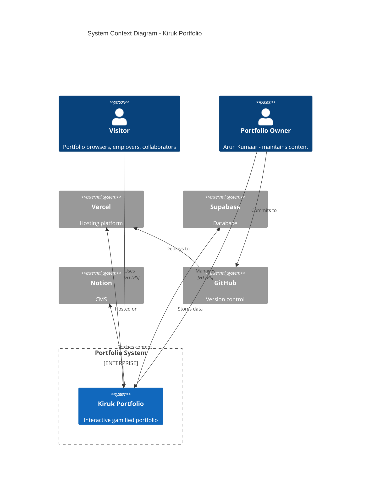
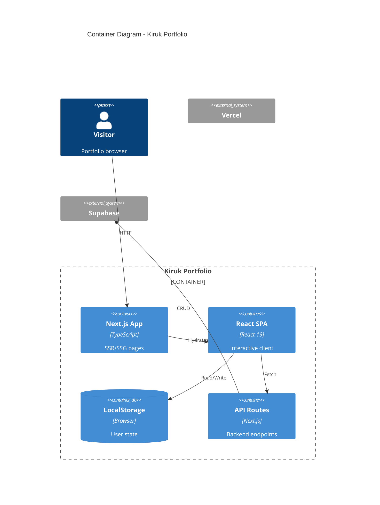
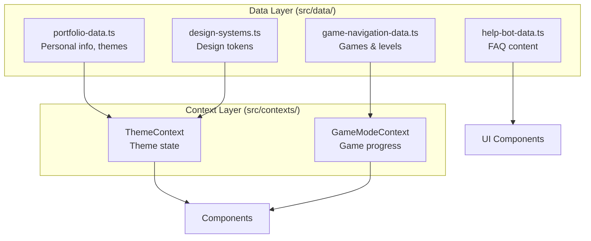
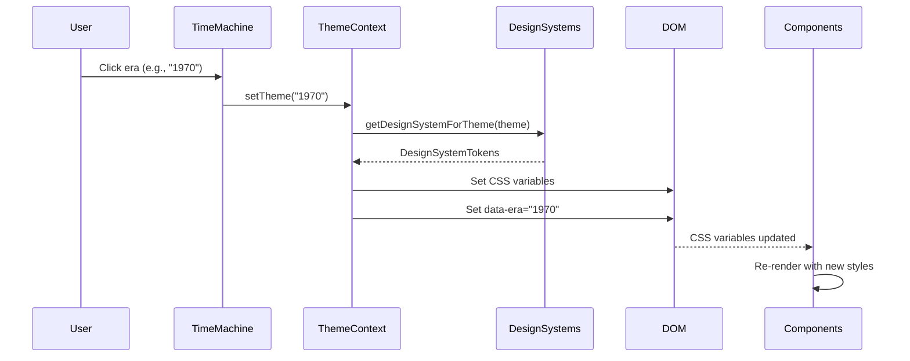
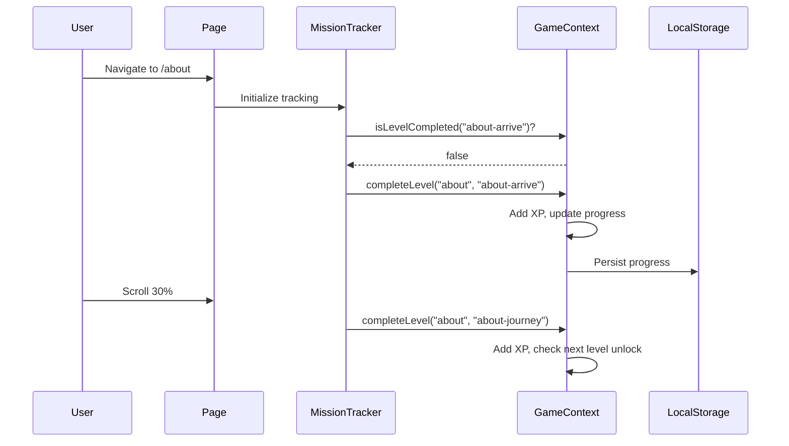
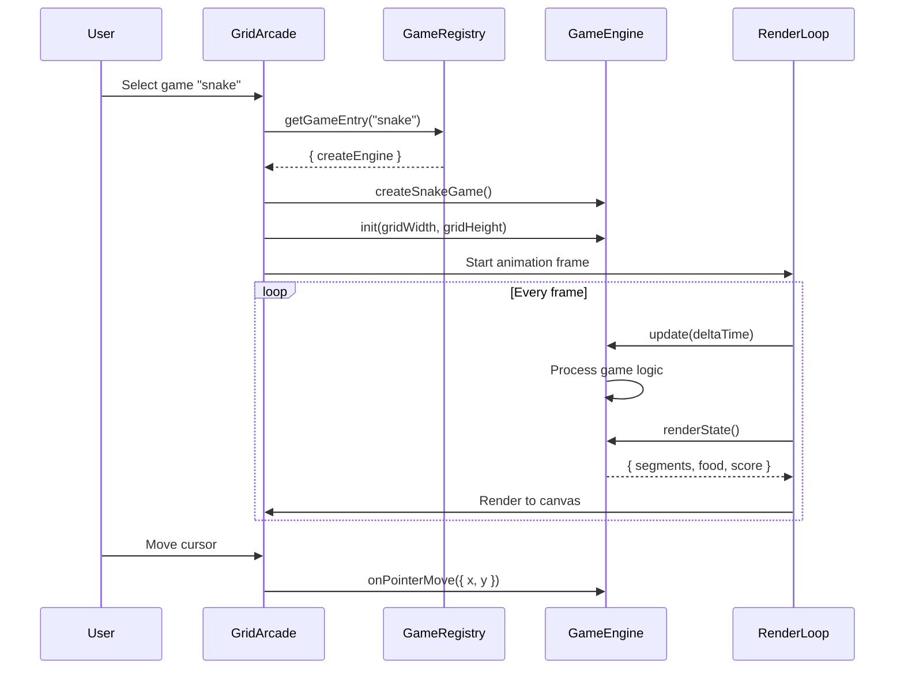
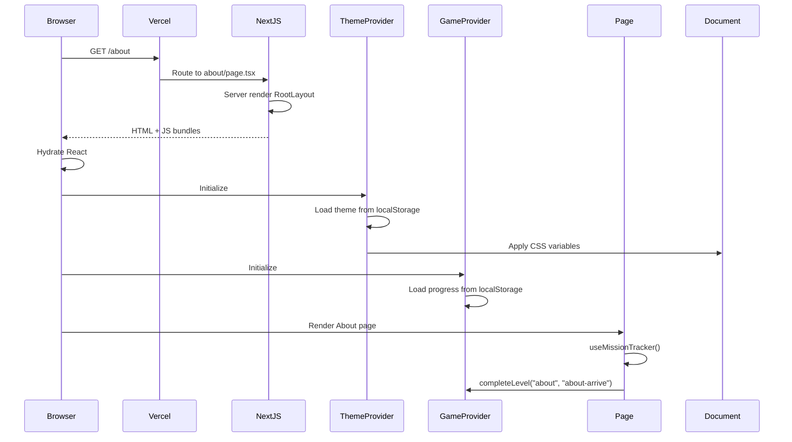
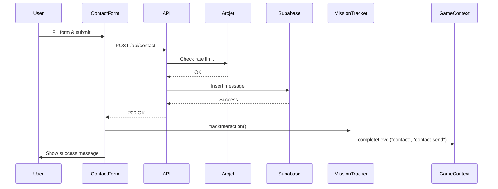
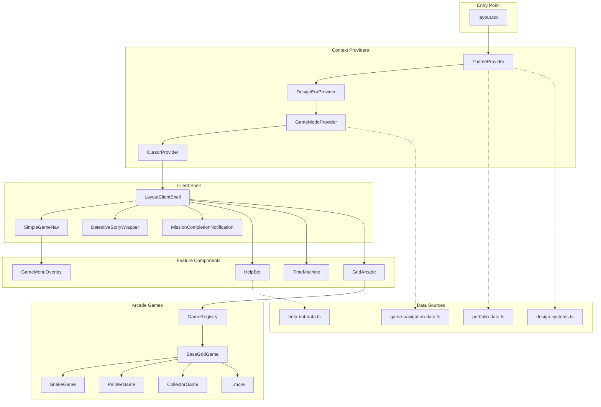

# 🏛️ Kiruk Portfolio - C4 Architecture Diagrams

> C4 Model documentation for the portfolio architecture
> Use tools like [PlantUML](https://plantuml.com/), [Structurizr](https://structurizr.com/), or [Mermaid](https://mermaid.js.org/) to render these diagrams.

---

## 📋 Table of Contents

1. [Level 1: System Context](#level-1-system-context)
2. [Level 2: Container Diagram](#level-2-container-diagram)
3. [Level 3: Component Diagram](#level-3-component-diagram)
4. [Data Flow Diagrams](#data-flow-diagrams)
5. [Sequence Diagrams](#sequence-diagrams)

---

## Level 1: System Context

The highest level view showing the portfolio in its environment.

### PlantUML

```plantuml
@startuml C4_Context
!include https://raw.githubusercontent.com/plantuml-stdlib/C4-PlantUML/master/C4_Context.puml

LAYOUT_WITH_LEGEND()

title System Context Diagram - Kiruk Portfolio

Person(visitor, "Visitor", "A person browsing the portfolio, potential employer, or collaborator")
Person(owner, "Portfolio Owner", "Arun Kumaar / KIRUK - maintains and updates content")

System(portfolio, "Kiruk Portfolio", "Interactive gamified portfolio with themes and mini-games")

System_Ext(vercel, "Vercel", "Hosting platform for Next.js app")
System_Ext(supabase, "Supabase", "Database for analytics and forms")
System_Ext(notion, "Notion API", "CMS for blog/content")
System_Ext(github, "GitHub", "Source code repository")

Rel(visitor, portfolio, "Browses, plays games, submits contact form", "HTTPS")
Rel(owner, portfolio, "Updates content, themes, games", "HTTPS/CLI")
Rel(portfolio, vercel, "Deployed on", "HTTPS")
Rel(portfolio, supabase, "Stores analytics, form data", "HTTPS")
Rel(portfolio, notion, "Fetches content", "HTTPS")
Rel(owner, github, "Pushes code", "Git")
Rel(github, vercel, "Triggers deployment", "Webhook")

@enduml
```

### Mermaid



---

## Level 2: Container Diagram

Shows the high-level technical building blocks.

### PlantUML

```plantuml
@startuml C4_Container
!include https://raw.githubusercontent.com/plantuml-stdlib/C4-PlantUML/master/C4_Container.puml

LAYOUT_WITH_LEGEND()

title Container Diagram - Kiruk Portfolio

Person(visitor, "Visitor", "Portfolio browser")

System_Boundary(portfolio, "Kiruk Portfolio") {
    Container(nextjs, "Next.js Application", "TypeScript, React 19", "Server-side rendered pages, client-side interactivity")
    Container(spa, "Client-Side App", "React, Framer Motion", "Interactive UI, games, theme switching")
    ContainerDb(localstorage, "Local Storage", "Browser API", "User preferences, game progress, theme selection")
    Container(api, "API Routes", "Next.js API", "Contact form, analytics, data endpoints")
}

System_Ext(vercel, "Vercel Edge", "CDN & Functions")
System_Ext(supabase, "Supabase DB", "PostgreSQL")
System_Ext(arcjet, "Arcjet", "Security & Rate Limiting")

Rel(visitor, nextjs, "Requests pages", "HTTPS")
Rel(nextjs, visitor, "Returns HTML/JS", "HTTPS")
Rel(visitor, spa, "Interacts with", "Browser")
Rel(spa, localstorage, "Persists state", "JS API")
Rel(spa, api, "Makes requests", "Fetch/HTTPS")
Rel(api, supabase, "Stores data", "HTTPS")
Rel(api, arcjet, "Security checks", "HTTPS")
Rel(nextjs, vercel, "Deployed on", "Edge")

@enduml
```

### Mermaid



---

## Level 3: Component Diagram

### A. Data Layer Components

```plantuml
@startuml C4_Component_Data
!include https://raw.githubusercontent.com/plantuml-stdlib/C4-PlantUML/master/C4_Component.puml

LAYOUT_WITH_LEGEND()

title Component Diagram - Data Layer

Container_Boundary(data_layer, "Data Layer - src/data/") {
    Component(portfolio_data, "portfolio-data.ts", "TypeScript", "Personal info, skills, projects, themes configuration")
    Component(design_systems, "design-systems.ts", "TypeScript", "Design tokens per theme style (sketch, minimal, absurd)")
    Component(game_nav, "game-navigation-data.ts", "TypeScript", "Page games, levels, XP rewards, unlock requirements")
    Component(help_bot, "help-bot-data.ts", "TypeScript", "FAQ content, page-specific help")
    Component(page_info, "page-info.ts", "TypeScript", "Page metadata, descriptions")
}

Container_Boundary(contexts, "Context Layer - src/contexts/") {
    Component(theme_ctx, "ThemeContext", "React Context", "Manages current theme, CSS variables")
    Component(game_ctx, "GameModeContext", "React Context", "Manages game progress, XP, modes")
}

Rel(theme_ctx, portfolio_data, "Reads themes from", "import")
Rel(theme_ctx, design_systems, "Gets tokens via", "getDesignSystemForTheme()")
Rel(game_ctx, game_nav, "Reads games/levels from", "import")

@enduml
```

### Mermaid Version



### B. UI Component Architecture

```plantuml
@startuml C4_Component_UI
!include https://raw.githubusercontent.com/plantuml-stdlib/C4-PlantUML/master/C4_Component.puml

LAYOUT_WITH_LEGEND()

title Component Diagram - UI Layer

Container_Boundary(layout, "Layout Components") {
    Component(root_layout, "RootLayout", "layout.tsx", "Root HTML, provider hierarchy")
    Component(client_shell, "LayoutClientShell", "Client", "Main client wrapper, game coordination")
    Component(simple_nav, "SimpleGameNav", "Client", "Top navigation, XP bar")
    Component(game_menu, "GameMenuOverlay", "Client", "Full-screen game menu")
    Component(detective, "DetectiveStoryWrapper", "Client", "Story hint overlays")
}

Container_Boundary(ui, "UI Components") {
    Component(time_machine, "TimeMachine", "Client", "Era/theme selector")
    Component(help_bot, "HelpBot", "Client", "AI assistant overlay")
    Component(pixel_icon, "PixelIcon", "Server", "448 pixel icons")
    Component(grid_background, "GridBackground", "Client", "20px grid patterns")
}

Container_Boundary(arcade, "Arcade System") {
    Component(grid_arcade, "GridArcade", "Client", "Game container")
    Component(base_game, "BaseGridGame", "Class", "Base game logic")
    Component(game_registry, "GameRegistry", "Data", "Game factory registry")
    Component(games, "Game Classes", "Classes", "12 individual games")
}

Rel(root_layout, client_shell, "Wraps", "children")
Rel(client_shell, simple_nav, "Renders", "JSX")
Rel(client_shell, detective, "Renders", "JSX")
Rel(client_shell, help_bot, "Renders", "JSX")
Rel(client_shell, grid_arcade, "Conditionally renders", "JSX")
Rel(simple_nav, game_menu, "Opens", "state")
Rel(grid_arcade, game_registry, "Gets game from", "getGameEntry()")
Rel(games, base_game, "Extends", "inheritance")

@enduml
```

### Mermaid Version

```mermaid
graph TB
    subgraph Layout["Layout Components"]
        RL[RootLayout<br/>Provider hierarchy] --> LCS[LayoutClientShell<br/>Main wrapper]
        LCS --> SGN[SimpleGameNav<br/>Top nav + XP bar]
        LCS --> DSW[DetectiveStoryWrapper]
        LCS --> HB[HelpBot]
        SGN --> GMO[GameMenuOverlay]
    end

    subgraph UI["UI Components"]
        TM[TimeMachine<br/>Era selector]
        PI[PixelIcon<br/>448 icons]
        GB[GridBackground]
    end

    subgraph Arcade["Arcade System"]
        GA[GridArcade] --> GR[GameRegistry]
        GR --> BG[BaseGridGame]
        BG --> Snake
        BG --> Painter
        BG --> Collector
        BG --> "...8 more"
    end

    LCS --> GA
    LCS --> TM
```

---

## Data Flow Diagrams

### Theme Switching Flow



### Game Progress Flow



### Arcade Game Flow



---

## Sequence Diagrams

### Full Page Load Sequence



### Contact Form Submission



---

## Visual Architecture Summary

```
┌─────────────────────────────────────────────────────────────────────────────┐
│                           KIRUK PORTFOLIO ARCHITECTURE                       │
├─────────────────────────────────────────────────────────────────────────────┤
│                                                                              │
│  ┌─────────────────────────────────────────────────────────────────────┐    │
│  │                         EXTERNAL SERVICES                            │    │
│  │  ┌──────────┐  ┌──────────┐  ┌──────────┐  ┌──────────┐            │    │
│  │  │ Vercel   │  │ Supabase │  │ Notion   │  │ Arcjet   │            │    │
│  │  │ (Host)   │  │ (DB)     │  │ (CMS)    │  │ (Security)│           │    │
│  │  └──────────┘  └──────────┘  └──────────┘  └──────────┘            │    │
│  └─────────────────────────────────────────────────────────────────────┘    │
│                                    │                                         │
│  ┌─────────────────────────────────┼─────────────────────────────────────┐  │
│  │                     NEXT.JS APPLICATION                                │  │
│  │                                 │                                       │  │
│  │  ┌──────────────────────────────┴──────────────────────────────────┐  │  │
│  │  │                        API LAYER                                 │  │  │
│  │  │  /api/contact  /api/analytics  /api/chat  /api/github           │  │  │
│  │  └──────────────────────────────────────────────────────────────────┘  │  │
│  │                                 │                                       │  │
│  │  ┌──────────────────────────────┼──────────────────────────────────┐  │  │
│  │  │                    DATA LAYER (src/data/)                        │  │  │
│  │  │  ┌──────────────┐ ┌──────────────┐ ┌──────────────┐            │  │  │
│  │  │  │ portfolio-   │ │ design-      │ │ game-        │            │  │  │
│  │  │  │ data.ts      │ │ systems.ts   │ │ navigation   │            │  │  │
│  │  │  │              │ │              │ │ -data.ts     │            │  │  │
│  │  │  │ • Personal   │ │ • Tokens     │ │ • PageGames  │            │  │  │
│  │  │  │ • Projects   │ │ • Components │ │ • Levels     │            │  │  │
│  │  │  │ • Themes     │ │ • Era maps   │ │ • XP         │            │  │  │
│  │  │  └──────────────┘ └──────────────┘ └──────────────┘            │  │  │
│  │  └──────────────────────────────────────────────────────────────────┘  │  │
│  │                                 │                                       │  │
│  │  ┌──────────────────────────────┼──────────────────────────────────┐  │  │
│  │  │                  CONTEXT LAYER (src/contexts/)                   │  │  │
│  │  │  ┌──────────────┐ ┌──────────────┐ ┌──────────────┐            │  │  │
│  │  │  │ Theme        │ │ GameMode     │ │ DesignEra    │            │  │  │
│  │  │  │ Context      │ │ Context      │ │ Context      │            │  │  │
│  │  │  │              │ │              │ │              │            │  │  │
│  │  │  │ • Theme      │ │ • Progress   │ │ • Era state  │            │  │  │
│  │  │  │ • CSS vars   │ │ • XP         │ │              │            │  │  │
│  │  │  │ • Tokens     │ │ • Mode       │ │              │            │  │  │
│  │  │  └──────────────┘ └──────────────┘ └──────────────┘            │  │  │
│  │  └──────────────────────────────────────────────────────────────────┘  │  │
│  │                                 │                                       │  │
│  │  ┌──────────────────────────────┼──────────────────────────────────┐  │  │
│  │  │                   UI LAYER (src/components/)                     │  │  │
│  │  │                                                                   │  │  │
│  │  │   ┌────────────────────────────────────────────────────────┐    │  │  │
│  │  │   │                    LAYOUT SHELL                         │    │  │  │
│  │  │   │  RootLayout → ThemeProvider → GameProvider →            │    │  │  │
│  │  │   │  LayoutClientShell → SimpleGameNav + Page + HelpBot     │    │  │  │
│  │  │   └────────────────────────────────────────────────────────┘    │  │  │
│  │  │                                                                   │  │  │
│  │  │   ┌────────────────────────────────────────────────────────┐    │  │  │
│  │  │   │                    ARCADE SYSTEM                        │    │  │  │
│  │  │   │  GridArcade ← GameRegistry ← BaseGridGame               │    │  │  │
│  │  │   │       ↓                           ↑                     │    │  │  │
│  │  │   │  12 Games: Snake, Painter, Collector, Avoider,          │    │  │  │
│  │  │   │           Tetris, Pipe, Shooter, Minesweeper,           │    │  │  │
│  │  │   │           Flappy, Timeline, Quiz, Memory                │    │  │  │
│  │  │   └────────────────────────────────────────────────────────┘    │  │  │
│  │  │                                                                   │  │  │
│  │  │   ┌────────────────────────────────────────────────────────┐    │  │  │
│  │  │   │                   SPECIAL COMPONENTS                    │    │  │  │
│  │  │   │  TimeMachine    HelpBot    GameMenuOverlay    PixelIcon │    │  │  │
│  │  │   └────────────────────────────────────────────────────────┘    │  │  │
│  │  └──────────────────────────────────────────────────────────────────┘  │  │
│  │                                                                         │  │
│  └─────────────────────────────────────────────────────────────────────────┘  │
│                                                                              │
│  ┌─────────────────────────────────────────────────────────────────────┐    │
│  │                         CLIENT BROWSER                               │    │
│  │  ┌──────────────┐  ┌──────────────┐  ┌──────────────┐              │    │
│  │  │ LocalStorage │  │ CSS Vars     │  │ Canvas/DOM   │              │    │
│  │  │ (Progress)   │  │ (Themes)     │  │ (Rendering)  │              │    │
│  │  └──────────────┘  └──────────────┘  └──────────────┘              │    │
│  └─────────────────────────────────────────────────────────────────────┘    │
│                                                                              │
└─────────────────────────────────────────────────────────────────────────────┘
```

---

## File Structure Diagram

```
kiruk-in/
│
├── 📁 src/
│   │
│   ├── 📁 app/                          # Next.js App Router
│   │   ├── 📄 layout.tsx                # Root - Provider hierarchy
│   │   ├── 📄 page.tsx                  # Home → NewspaperLayout
│   │   ├── 📄 globals.css               # CSS vars, era styles
│   │   ├── 📁 about/page.tsx            # About page
│   │   ├── 📁 work/                     # Work pages
│   │   ├── 📁 case-studies/             # Case study pages
│   │   ├── 📁 contact/                  # Contact page
│   │   ├── 📁 arcade/                   # Arcade page
│   │   └── 📁 api/                      # API routes
│   │
│   ├── 📁 data/                         # 📊 DATA LAYER
│   │   ├── 📄 portfolio-data.ts         # Content + Themes
│   │   ├── 📄 design-systems.ts         # Design tokens
│   │   ├── 📄 game-navigation-data.ts   # Games + Levels
│   │   └── 📄 help-bot-data.ts          # FAQ content
│   │
│   ├── 📁 contexts/                     # 🔄 STATE LAYER
│   │   ├── 📄 ThemeContext.tsx          # Theme management
│   │   ├── 📄 GameModeContext.tsx       # Game progress
│   │   └── 📄 DesignEraContext.tsx      # Era tracking
│   │
│   ├── 📁 components/                   # 🧩 UI LAYER
│   │   ├── 📁 layout/                   # Layout components
│   │   │   ├── 📄 LayoutClientShell.tsx # Main wrapper
│   │   │   ├── 📄 SimpleGameNav.tsx     # Navigation
│   │   │   ├── 📄 GameMenuOverlay.tsx   # Menu
│   │   │   └── 📄 newspaper-layout.tsx  # Home page
│   │   │
│   │   └── 📁 ui/                       # UI primitives
│   │       ├── 📄 TimeMachine.tsx       # Era switcher
│   │       ├── 📄 HelpBot.tsx           # AI assistant
│   │       ├── 📄 PixelIcon.tsx         # Icons
│   │       └── 📁 arcade/               # 🎮 GAMES
│   │           ├── 📄 GridArcade.tsx    # Game container
│   │           ├── 📄 base-grid-game.ts # Base class
│   │           ├── 📄 game-registry.ts  # Game factory
│   │           ├── 📄 game-configs.ts   # Game settings
│   │           └── 📁 games/            # 12 game classes
│   │
│   ├── 📁 hooks/                        # Custom hooks
│   │   ├── 📄 useMissionTracker.ts      # Auto-track missions
│   │   └── 📄 useGridAlignment.ts       # Grid utilities
│   │
│   ├── 📁 lib/                          # Utilities
│   │   ├── 📄 utils.ts                  # Grid helpers
│   │   ├── 📄 supabase.ts               # Database
│   │   └── 📄 arcjet.ts                 # Security
│   │
│   └── 📁 types/                        # TypeScript types
│       └── 📄 index.ts
│
├── 📁 public/                           # Static assets
│   ├── 📁 icons/                        # 448 pixel icons
│   └── 📁 images/
│
└── 📁 docs/                             # Documentation
    ├── 📄 ARCHITECTURE.md               # This guide
    └── 📄 C4_DIAGRAMS.md               # C4 diagrams
```

---

## Component Dependency Graph



---

## Usage

### Rendering PlantUML Diagrams

1. **Online**: Paste code into [PlantUML Web Server](https://www.plantuml.com/plantuml/uml/)
2. **VS Code**: Install "PlantUML" extension
3. **CLI**: `java -jar plantuml.jar C4_DIAGRAMS.md`

### Rendering Mermaid Diagrams

1. **GitHub**: Renders automatically in markdown
2. **VS Code**: Install "Markdown Preview Mermaid" extension
3. **Online**: [Mermaid Live Editor](https://mermaid.live/)

---

## Legend

| Symbol | Meaning |
|--------|---------|
| 📁 | Directory |
| 📄 | File |
| → | Data flow / import |
| -.-> | Loose coupling / reads |
| ──► | Renders / contains |
| ◄── | Receives data from |

---

*Generated for Kiruk Portfolio v0.1.0*
